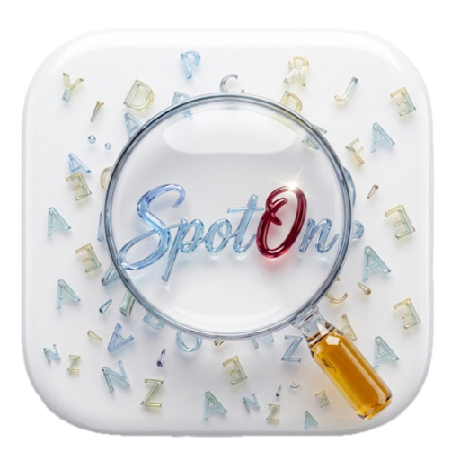

<div align="center">

<picture>
  <source media="(prefers-color-scheme: dark)" srcset="docs/assets/logo-dark.png">
  <source media="(prefers-color-scheme: light)" srcset="docs/assets/logo-light.png">
  
</picture>

# SpotOn

### *Master English, One Word at a Time*

An elegant English-vocabulary companion for Hebrew speakers —
capture words from real life, practice them in five game modes,
and talk them through with an AI tutor.

<br>


</div>

---

## ✨ What is SpotOn?

You hear a new English word in a meeting, a series, or on the street —
**SpotOn turns that moment into lasting vocabulary.** Save the word with its
context, let AI enrich it with a definition, part of speech and real usage
examples, then lock it in through fast, beautiful practice games — all
bilingual, English ↔ Hebrew.

---

## 🎯 Features

| | Feature | What it does |
|:---:|---|---|
| 📚 | **Personal Word Bank** | Save words with context, tags, level and Hebrew translation — synced to the cloud, searchable, paginated |
| 🤖 | **AI Enrichment** | Every saved word is automatically enriched by Gemini: definition, part of speech, and business / casual / tech example sentences |
| 📖 | **Reading Pathways** | Leveled reading passages with tappable vocabulary, glassmorphism word popups, text-to-speech and comprehension quizzes |
| ⚡ | **60-Second Blitz** | Race the clock — swipe and tap through your words before time runs out |
| 🃏 | **Flashcards** | Flip between English and Hebrew; study your own bank or curated level packs |
| ✍️ | **Sentence Completion** | Fill in the blank, then see the full Hebrew translation |
| 📸 | **Snap & Learn** | Point your camera at anything — Gemini Vision names it in English and Hebrew |
| 💬 | **AI English Tutor** | Chat *or hold a live voice call* with a Gemini-powered tutor that gently corrects your mistakes |
| 🏆 | **Friends & Leaderboard** | Invite friends with a 6-character code and compete on XP, streaks and word counts |
| 🔔 | **Streaks & Reminders** | Daily streak tracking and a configurable practice reminder |
| 🌗 | **Full Dark Mode** | The entire Crystal design system adapts — including the app icon and splash screen |
| 📱 | **Home-Screen Widget** | Idiom of the Day, straight on your home screen |

---

## 🎮 Gamification

Every activity feeds one XP economy, synced live via Firebase Realtime Database:

| Action | Reward |
|---|:---:|
| Add a word (manual or camera) | **+10 XP** |
| Blitz — correct answer | **+5 XP** |
| Sentence Completion — correct answer | **+5 XP** |
| Reading quiz — correct answer *(first completion)* | **+5 XP** |
| Daily practice | **🔥 streak +1** |

---

## 🏛 Architecture

Clean **MVVM** with SwiftUI, `async/await` concurrency, and a strict
service layer:

```
SpotOn/
├── Models/          Word · ReadingPassage · UserProfile · Idiom · ChatMessage
├── ViewModels/      Auth · WordBank · Blitz · Chat · VoiceCall · ReadingPathway …
├── Views/           Dashboard · WordBank · Learn Hub · Reading · Settings …
├── Services/        Firestore · RealtimeDatabase · LLMEnrichment · Vision
│                    Speech · SpeechRecognizer · Friends · Notifications
├── Extensions/      CrystalTheme (design system) · helpers
└── Resources/       passages.json · sentences.json · vocabulary.json
```

**Data layer**
- ☁️ **Firestore** — word bank, user profiles, idioms, friends
- ⚡ **Realtime Database** — XP & streaks (atomic `ServerValue.increment`)
- 💾 **SwiftData** — reading passages and per-word progress, seeded on first launch
- 🧠 **Gemini 1.5 Flash** — tutor chat, voice-call replies, image recognition, word enrichment

---

## 🚀 Getting Started

**Requirements:** Xcode 16+, iOS 17+

```bash
git clone https://github.com/ofekfanian/SpotOn.git
cd SpotOn
```

**1 · Gemini API key**

```bash
cp SpotOn/Config/APIKeys.example.xcconfig SpotOn/Config/APIKeys.xcconfig
```

Paste your key (from [Google AI Studio](https://aistudio.google.com/apikey)) into
`APIKeys.xcconfig`. The file is gitignored — your key never leaves your machine.

**2 · Firebase**

Add your own `GoogleService-Info.plist` (from the
[Firebase console](https://console.firebase.google.com)) to the `SpotOn/` folder,
with Auth (Email/Password), Firestore and Realtime Database enabled.

**3 · Run**

Open `SpotOn.xcodeproj`, select the **SpotOn** scheme, and hit **⌘R**.

---

## 🎨 The Crystal Design System

A single design language across every screen — defined in
[`CrystalTheme.swift`](SpotOn/Extensions/CrystalTheme.swift):

- **Crystal palette** — `crystalBlue` · `crystalMint` · `crystalGold` gradients
- **Glassmorphism** — `.ultraThinMaterial` cards with gradient stroke borders
- **Scattered letters** — a subtle alphabet backdrop on every screen
- **Adaptive** — every component ships with light & dark variants

---

<div align="center">

Built with **SwiftUI & Firebase** · iOS course final project

© 2026 SpotOn — Ofek Fanian

</div>
